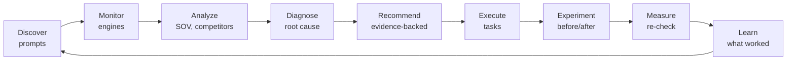
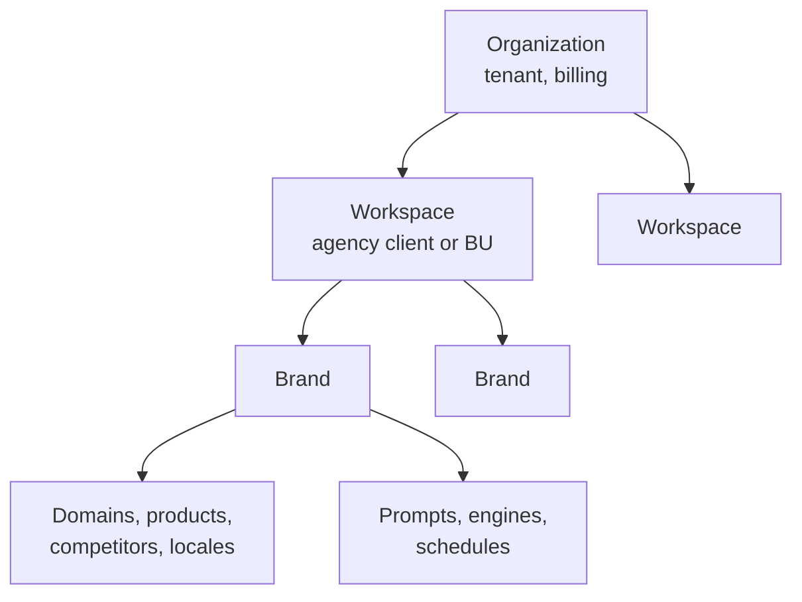
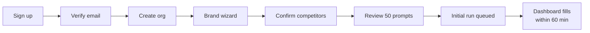
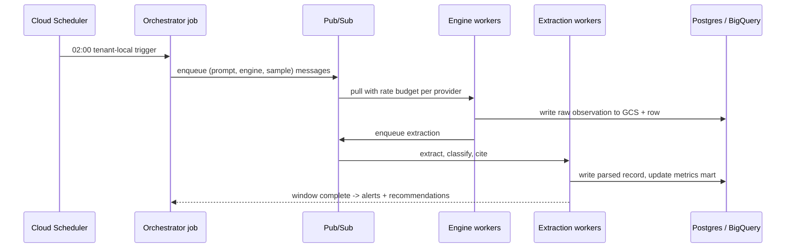
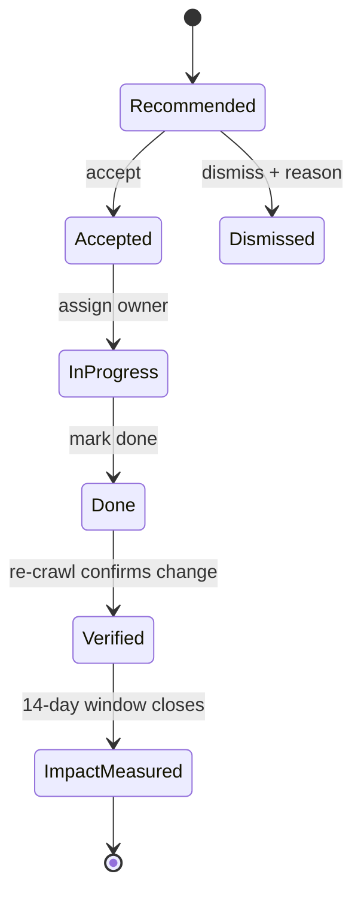
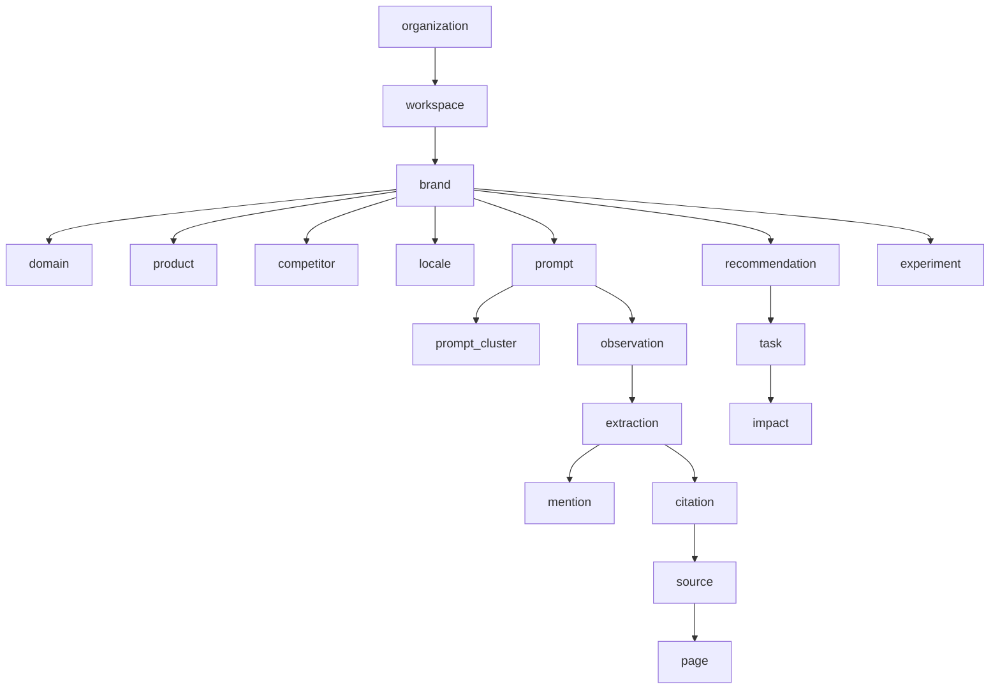
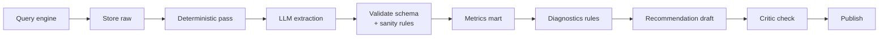
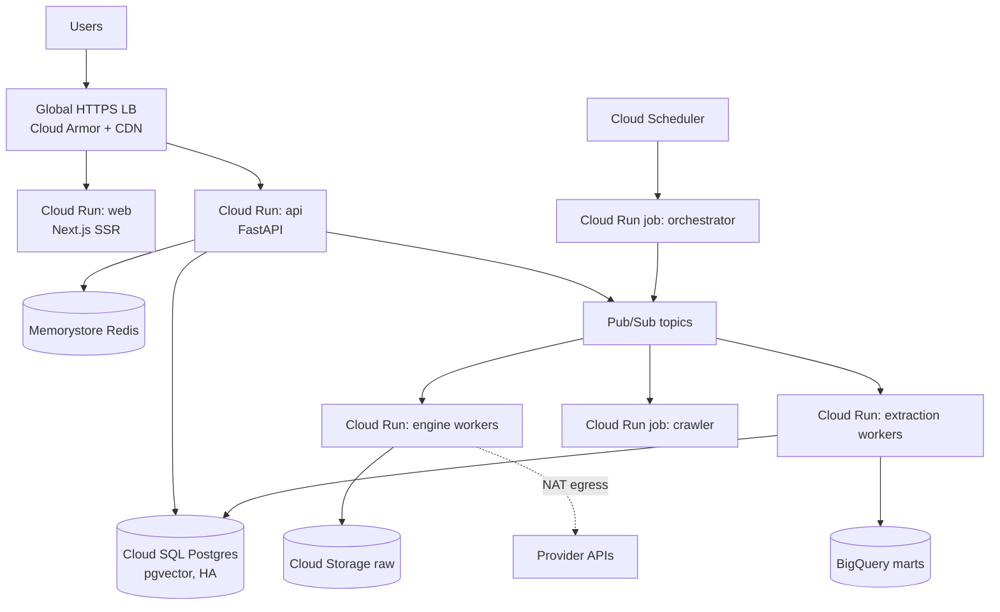

# Brand Search Intelligence Platform — Product Requirements Document (PRD)

2026-09-18 · @Someone

This PRD is the single source of truth for building the Brand Search Intelligence + AI Visibility Optimization platform (working name **Lumenca**) as a production-ready, multi-tenant web application on Google Cloud Platform. It supersedes the ADK demo and builds on the transformation plan delivered on 18 Sep 2026.

## 1. Document control

| Item | Value |
| --- | --- |
| Product | Brand Search Intelligence + AI Visibility Optimization platform (working name: Lumenca; final name pending trademark clearance) |
| Owner | Vineet, AIxAI |
| Audience | Product, design, engineering, DevOps, QA, security |
| Status | Draft v1.0 for review |
| Scope | MVP (Phase 1, 90 days) through Enterprise (Phase 3, 12 months) |
| Related | Transformation plan (18 Sep 2026); ADK demo test guide (18 Sep 2026) |

### 1.1 Assumptions

- The existing ADK application is treated as a reference implementation only; its generator/critic loop, `google_search` grounding, BigQuery access and eval discipline are reused as internal libraries, not as the product runtime.
- AI engines are queried through official APIs with web search (OpenAI Responses `web_search`, Anthropic web search tool, Gemini grounding, Perplexity Sonar). Google SERP, AI Overviews and AI Mode data come from a licensed SERP data provider (primary: DataForSEO; fallback: SerpApi). Consumer-UI scraping is out of scope for the core pipeline.
- AI answers are probabilistic. Every visibility metric is computed from repeated samples (default 3 in MVP, 7 for Pro/Enterprise) and reported with sample size and a 95% confidence interval.
- Both India and global (US/EU) customers are targeted from day one; the beachhead is India D2C/e-commerce brands and agencies.
- One engineering pod (2 backend, 2 frontend, 1 data/AI, 1 DevOps, 1 QA, 1 designer, 1 PM) delivers Phase 1.

### 1.2 Constraints

- GCP only for cloud infrastructure; region pairing `asia-south1` (Mumbai) primary and `us-central1` for US-resident tenants.
- Third-party API cost must stay under 35% of revenue at the Pro tier; cost per monitored prompt is a first-class metric.
- No feature may promise rankings, AI recommendations, Knowledge Panels or citations. Proprietary scores are labelled as diagnostics.
- No fake searches, engagement, reviews or manipulation features, ever.
- India DPDP Act and GDPR compliance required before Phase 2 general availability.

### 1.3 Dependencies

| Dependency | Type | Risk if unavailable |
| --- | --- | --- |
| OpenAI, Anthropic, Google, Perplexity APIs | External | Engine coverage gaps; provider abstraction with feature flags mitigates |
| DataForSEO / SerpApi | External | No Google AIO/AI Mode data; dual-provider adapter mitigates |
| Stripe + Razorpay | External | Billing for global + India; Phase 1 uses Stripe only |
| Google Search Console API | External | Optional enrichment; feature degrades gracefully |
| Trademark clearance for product name | Internal | Rebrand cost if late; clear before public launch |

### 1.4 Glossary

| Term | Meaning |
| --- | --- |
| Prompt | A natural-language query submitted to an AI engine or search engine on behalf of a brand |
| Observation | One sampled response from one engine for one prompt at one time, stored raw and parsed |
| Mention rate | Share of observations in which the brand is named |
| Recommendation rate | Share of observations in which the brand is presented as a recommended choice |
| Citation | A URL an engine references in support of its answer |
| SOV | Share of voice: brand mentions divided by brand plus tracked competitor mentions |
| Recommendation | An evidence-backed suggested action generated by the platform |
| Task | A recommendation accepted into the action workflow with owner, due date and status |
| Experiment | A before/after measurement window around a completed change |
| Tenant | An Organization; the unit of data isolation |

## 2. Product overview

The platform answers one question: when customers search for a problem, category, product or recommendation, how visible is a brand across Google and AI answer engines, and what exactly should the brand do next.

### 2.1 Category and positioning

- Category: AI Visibility & Brand Search Intelligence (combines AI search visibility, Brand SERP optimization and GEO/AEO).
- One-line definition: a platform that shows exactly how visible a brand is across Google and AI answer engines, and turns that into an evidence-backed, measurable action plan.
- Ideal customer: mid-market B2B SaaS and D2C brands, and the agencies serving them; enterprise tier from Phase 3.
- Differentiator: citation-opportunity discovery, root-cause diagnosis and closed-loop experiments on reproducible, uncertainty-aware measurement, plus an e-commerce product-title wedge and India-language depth.

### 2.2 Core product loop

Every screen answers four questions: what happened, why, what should I do, did my action work.

### 2.3 Goals (Phase 1, first 90 days)

| Goal | Target | Measured by |
| --- | --- | --- |
| Monitoring live across 4 AI engines + Google surfaces | Day 30 | Observations stored daily for 100% of active prompts |
| Visibility metrics with confidence intervals | Day 45 | Dashboard renders mention, recommendation, citation rate, SOV with CI and n |
| Recommendation engine and task workflow | Day 75 | 100% of recommendations carry evidence links; tasks re-checked after completion |
| 10 paying design-partner brands (India D2C + agencies) | Day 90 | Active subscriptions |
| Cost per monitored prompt per engine per day | ≤ $0.02 blended | FinOps dashboard |

### 2.4 Non-goals

- Full SEO suite parity with Semrush or Ahrefs (backlinks index, keyword database at scale).
- Consumer-UI scraping of ChatGPT, Gemini or Perplexity.
- Auto-publishing content to customer CMSs without human approval (Phase 3 pilot only, approval-gated).
- Paid media, social scheduling, or review-response automation.

### 2.5 Success metrics

| Metric | Phase 1 target | Phase 3 target |
| --- | --- | --- |
| Active brands | 25 | 400 |
| Prompts monitored per day | 5,000 | 250,000 |
| Recommendation acceptance rate | 30% | 50% |
| Tasks with measured impact | 60% of completed | 90% of completed |
| Gross margin | 55% | 72% |
| Net revenue retention | n/a | 110% |

## 3. Users, roles and permissions

Access is scoped Organization → Workspace → Brand, with six roles enforced by RBAC in the API layer and by row-level security in Postgres.

### 3.1 Hierarchy

An Organization is the tenant and billing unit. A Workspace groups brands (an agency client, a business unit, a region). Users belong to an Organization and receive roles per Workspace.

### 3.2 Roles

| Role | Scope | Intended user |
| --- | --- | --- |
| Org Owner | Organization | Founder, agency principal; billing, SSO, org settings |
| Org Admin | Organization | Ops lead; all workspaces, user management, no billing |
| Workspace Admin | Workspace | Account manager; brands, members, integrations in that workspace |
| Editor | Workspace or Brand | SEO/content/PR practitioner; prompts, tasks, experiments |
| Viewer | Workspace or Brand | CMO, client stakeholder; read-only dashboards and reports |
| API Service Account | Workspace | Machine access with scoped API key |

### 3.3 Permission matrix

| Capability | Owner | Org Admin | WS Admin | Editor | Viewer | Service |
| --- | --- | --- | --- | --- | --- | --- |
| Manage billing and plan | Yes | No | No | No | No | No |
| Configure SSO, SCIM, data residency | Yes | Yes | No | No | No | No |
| Create or delete workspace | Yes | Yes | No | No | No | No |
| Invite users, assign roles | Yes | Yes | WS only | No | No | No |
| Create or archive brand | Yes | Yes | Yes | No | No | Scoped |
| Edit brand entities, competitors, locales | Yes | Yes | Yes | Yes | No | Scoped |
| Create, edit, pause prompts | Yes | Yes | Yes | Yes | No | Scoped |
| Trigger on-demand audit | Yes | Yes | Yes | Yes | No | Scoped |
| View dashboards, reports | Yes | Yes | Yes | Yes | Yes | Read |
| Accept recommendation into task, assign, close | Yes | Yes | Yes | Yes | No | Scoped |
| Create experiment | Yes | Yes | Yes | Yes | No | Scoped |
| Configure alerts | Yes | Yes | Yes | Yes | Own only | No |
| White-label and client portal settings | Yes | Yes | Yes | No | No | No |
| Export raw observations | Yes | Yes | Yes | No | No | Read |
| View audit log | Yes | Yes | WS only | No | No | No |
| Manage API keys | Yes | Yes | WS only | No | No | No |

### 3.4 Rules

- Every API request resolves to (user or service account, organization, workspace, brand set) and sets `app.tenant_id` on the database session; RLS policies filter every tenant-scoped table.
- Roles are additive across workspaces; the highest role wins within a workspace.
- Client portal users (Phase 2) are Viewers restricted to one workspace with white-label branding.
- All role changes, exports and deletions are written to the immutable audit log.

## 4. Functional requirements

Sixteen feature modules make up the product; each lists its user stories, requirements and acceptance criteria. Priority: P0 = Phase 1 launch blocker, P1 = Phase 1 or early Phase 2, P2 = Phase 2, P3 = Phase 3.

### F01 Onboarding and brand setup (P0)

**User story.** As a marketing lead, I add my brand, domain, products and competitors in under 10 minutes and see a first visibility snapshot within an hour.

Requirements:

- Sign up with email + password or Google; email verification; org created on first login.
- Brand wizard: name, aliases (min 1, max 20), primary domain, additional domains, category, products (name + URL), competitors (name + domain, max 10 on Starter, 25 on Pro, unlimited Enterprise), target countries and languages.
- Auto-suggest competitors from a seed engine query; user confirms each.
- Auto-generate 50 starter prompts (F02) on brand creation and queue an initial monitoring run.
- Optional: connect Google Search Console (OAuth) and a Shopify or product feed for the e-commerce wedge (F16).

Acceptance criteria:

- Brand creation with all required fields completes in a single wizard; validation errors are inline.
- Initial run for 50 prompts across enabled engines completes within 60 minutes of creation.
- Alias matching correctly distinguishes `Nike` from `NikeKids` in the benchmark set (precision ≥ 0.97).

### F02 Prompt intelligence (P0)

**User story.** As a content director, I want the platform to discover the questions customers ask about my category so I monitor what matters, not what I guessed.

Requirements:

- Generate prompts across 10 intent classes: informational, commercial, transactional, comparison, alternative, recommendation, problem-based, industry-specific, persona-specific, geographic.
- Sources: LLM generation seeded by brand/category/products; Google autocomplete and People Also Ask via SERP provider; Search Console queries (if connected); optional CSV import; manual entry.
- Deduplicate with embeddings (cosine ≥ 0.92 = duplicate); cluster by intent, topic, funnel stage, persona, product, geography, language.
- Localized prompts per country/language including Hindi and Hinglish variants.
- Prompt states: suggested, active, paused, archived; plan-based active limits (Starter 100, Pro 500, Agency 2,000 per workspace, Enterprise custom).
- Prompt volume estimate (low/medium/high) from keyword APIs where available, labelled as estimate.

Acceptance criteria:

- 50 starter prompts generated in ≤ 90 s with ≤ 5% near-duplicates on the benchmark set.
- Each prompt shows intent, cluster, locale and source badge.
- Plan limits enforced at API and UI.

### F03 Multi-engine monitoring pipeline (P0)

**User story.** As an SEO director, I need daily observations for every active prompt on every enabled engine, with full raw data for audit.

Requirements:

- Engines Phase 1: ChatGPT (OpenAI Responses API with `web_search`), Gemini (grounding), Perplexity (Sonar), Claude (web search tool), Google organic + AI Overviews + AI Mode (SERP provider). Phase 2: Copilot, Grok, Google Images, YouTube, news.
- Cadence per plan: daily (Pro/Agency/Enterprise), every 3 days (Starter); on-demand run limited by quota.
- Samples per prompt per engine: 3 (Starter, Pro), 7 (Agency, Enterprise), configurable up to 10.
- Store for each observation: prompt, engine, model, model version, timestamp, locale, device hint, request parameters, full raw response, citations, parsed extraction, pipeline version.
- Provider adapters with retries, exponential backoff, circuit breakers, rate-limit budgets per provider, and a fallback SERP provider.
- Idempotent job execution; a re-run never creates duplicate observations for the same (prompt, engine, scheduled slot, sample index).

Acceptance criteria:

- 99% of scheduled observations complete within the 6-hour daily window.
- Raw payload retrievable for any observation within 12 months.
- Provider outage for 1 engine does not block other engines (verified by chaos test).

### F04 Answer analysis and extraction (P0)

**User story.** As an analyst, I want each AI answer parsed into brand presence, position, recommendation status, competitors, sentiment, context and citations, with the reason the brand was absent when it was.

Requirements:

- Deterministic pass first: alias and domain matching (exact, fuzzy with edit distance ≤ 1 on tokens ≥ 5 chars, URL-domain match), citation URL parsing and domain normalization.
- LLM extraction pass (small model, JSON schema): mention position (ordinal in list or paragraph), recommendation status (recommended, listed, mentioned, negative), competitors named, sentiment (positive, neutral, negative, mixed) with confidence, context summary (≤ 40 words), absence reason class (not retrieved, competitor dominance, category mismatch, off-topic answer).
- Human-labelled benchmark of 1,000 observations; mention precision/recall ≥ 0.95, recommendation F1 ≥ 0.85, sentiment agreement ≥ 0.80.
- Re-extraction on pipeline version bump without re-querying engines.

Acceptance criteria:

- Every observation has an extraction record with `pipeline_version` and `model_used`.
- Benchmark thresholds enforced in CI; a regression blocks deploy.

### F05 Visibility metrics and share of voice (P0)

**User story.** As a CMO, I want honest visibility numbers I can compare week over week.

Metric definitions (all per brand, engine, prompt set, period):

| Metric | Formula |
| --- | --- |
| Mention rate | observations with brand mention / eligible observations |
| Recommendation rate | observations with status recommended / eligible observations |
| Average position | mean ordinal position when mentioned |
| Citation rate | observations citing a brand-owned domain / eligible observations |
| Share of voice | brand mentions / (brand mentions + Σ tracked competitor mentions) |
| Prompt coverage | prompts with ≥ 1 mention in the period / active prompts |
| Sentiment index | (positive − negative) / mentioned observations |
| Brand Visibility Score | weighted composite of the above plus Google visibility, entity consistency, SERP ownership; weights visible and versioned |

Requirements:

- Every metric displays n and a 95% Wilson confidence interval; deltas that do not clear the interval are shown as "no significant change".
- Composite score labelled "proprietary diagnostic, not an official engine metric" wherever shown.
- Aggregations pre-computed nightly into a metrics mart; on-demand recompute for custom filters within 5 s at p95.
- Metric methodology page with formulas and version history.

Acceptance criteria:

- Numbers on dashboard, report and API agree exactly for the same filter.
- Changing sample count changes CI width, not the point estimate method.

### F06 Citation intelligence and opportunity engine (P1)

**User story.** As a PR manager, I want to know which sites AI engines cite for my category and which of them mention competitors but not us.

Requirements:

- Citation table: domain, URL, page title, engine, frequency, first/last seen, cited for which prompts, which brands were mentioned in the citing answer, source type (vendor, review site, publication, community, docs, other), authority estimate (third-party metric where licensed, labelled estimate).
- Gap detection: sources citing ≥ 2 tracked competitors and 0 brand citations.
- Opportunity records: source, why relevant (prompts and clusters), competitors present, recommended action (outreach, listing, content contribution, correction), suggested content brief, priority score, status.
- Crawl cited pages (respecting robots.txt) to extract on-page brand mentions and structured data.

Acceptance criteria:

- For a brand with 5 competitors and 300 prompts, opportunity list is generated within 24 h of the first full run.
- Each opportunity links to ≥ 1 raw observation as evidence.

### F07 Competitor intelligence (P1)

Requirements:

- Per competitor: mention rate, recommendation rate, SOV, citation domains, sentiment, prompt coverage, week-over-week deltas.
- Visibility change feed: competitor gained or lost ≥ 10 percentage points on ≥ 10 prompts within 14 days, with linked evidence (new cited pages, new citing domains).
- Weekly crawl of competitor domains for new pages (sitemap diff) and new structured data.

Acceptance criteria: each change entry lists the prompts, engines and evidence URLs; false-positive rate on the benchmark ≤ 10%.

### F08 Entity intelligence and consistency audit (P1)

Requirements:

- Brand entity graph: brand, company, products, people, categories, features, partners, social profiles, review profiles, knowledge sources; editable by Editors; auto-seeded from the brand's site and schema.org markup.
- Consistency audit across website, About page, LinkedIn, Crunchbase, G2, Capterra, Wikipedia/Wikidata (where present), directories: compare name, description, category, founders, location, logo, social links; flag conflicts with severity.
- Schema.org checks: Organization (`name`, `url`, `logo`, `sameAs`, identifiers), WebSite, Product, Article, BreadcrumbList; explain each finding as an optimization signal, never a guaranteed outcome.

Acceptance criteria: audit runs on demand and monthly; each finding has location, observed value, expected value, and fix guidance.

### F09 Brand SERP audit (P1)

Requirements: for `[brand]` and `[brand] reviews` in each target locale, classify first-page results (official, social, review, news, competitor, negative, video, image, Knowledge Panel, sitelinks, AI Overview), compute SERP ownership share, and produce a Brand SERP Health Report with findings.

Acceptance criteria: report generated weekly; classification accuracy ≥ 0.9 on benchmark.

### F10 Site and AI crawlability audit (P1)

Requirements:

- Crawl up to 500 pages (Starter), 5,000 (Pro), 50,000 (Enterprise) with Playwright rendering for JS sites; respect robots.txt.
- Checks: robots directives for Googlebot, Bingbot, GPTBot, OAI-SearchBot, ClaudeBot, Claude-SearchBot, PerplexityBot, Google-Extended; sitemap validity; canonicals; indexability; titles, metas, H1; structured data validity; author attribution; `llms.txt` presence (labelled unofficial); CDN bot blocking detection via fetch with each bot UA.
- Each finding: severity, affected URLs, why it matters for AI/search discoverability, fix.

Acceptance criteria: crawl of 5,000 pages completes in ≤ 2 h; findings deduplicated by rule and URL pattern.

### F11 Content gap and optimization engine (P1)

Requirements:

- Content gaps: clusters where competitors are mentioned or cited and the brand is absent or weak; output target query, intent, recommended page type, evidence, competitors, citation sources, suggested structure, internal links, priority.
- URL optimizer: fetch page, score topic coverage, intent fit, entity coverage, evidence, author attribution, structure, FAQs, tables, direct answers; output add, remove, rewrite, evidence-to-add lists.
- AI Citability Score (0–100), proprietary diagnostic, components visible, weights versioned.

Acceptance criteria: URL analysis completes in ≤ 60 s p95; every suggestion cites the observation or competitor page that motivates it.

### F12 Recommendation engine and action plans (P0)

**User story.** As a marketing lead, I open the app and see the three most valuable things to do today, each with evidence and a plan.

Requirements:

- Recommendation types: create content, optimize page, fix entity inconsistency, fix crawlability, pursue citation source, respond to reputation issue, expand prompts, add competitor.
- Each recommendation: problem, evidence (linked observations, metrics, pages), root cause class, action steps, expected outcome (qualitative plus which metric should move), difficulty, priority score, suggested owner role.
- Generation: deterministic rules produce candidates from diagnostics; a large model drafts the plan text; the generator/critic loop (ported from the ADK demo) reviews for evidence completeness and forbidden claims (no guarantees, no manipulation).
- Priority score = expected reach (prompts affected × volume estimate) × competitor pressure × feasibility, weights visible.
- Recommendations regenerate weekly; accepted ones become Tasks (F13); dismissed ones record a reason.

Acceptance criteria: 100% of recommendations pass the critic check for evidence links and forbidden language before display; top-3 panel loads in ≤ 1.5 s.

### F13 Action management (P0)

Requirements:

- Task fields: title, linked recommendation, owner, due date, status (open, in progress, done, verified, impact measured), notes, attachments (URLs).
- Status flow with automatic re-check: on done, schedule re-crawl of affected URLs and a 14-day measurement window on affected prompts; on window close, compute before/after deltas with CI and set impact label (improved, no significant change, declined).
- Board and list views; assignment notifications by email; Slack/Teams webhooks (Phase 2).

Acceptance criteria: every task marked done gets an impact record within 16 days; impact visible on the task and in Learn analytics.

### F14 Experiments (P2)

Requirements: hypothesis, treatment prompts and control prompts, change description, before window (≥ 14 days), after window (≥ 14 days), metrics (mention, recommendation, citation, SOV) with CI; result labelled association not causation; minimum sample enforced (≥ 7 samples/prompt/day for experiments).

Acceptance criteria: an experiment cannot be marked significant unless the after-window CI excludes the before-window point estimate.

### F15 Alerts, reporting and agency mode (P1)

Requirements:

- Alerts on rolling windows only: mention rate drop ≥ 15 pts over 7 days, competitor displacement on ≥ 10 prompts, new negative mention cluster, new competitor citation source with authority above threshold, Brand SERP change; channels email, Slack, webhook; per-user preferences; digest mode.
- Reports: CMO summary, SEO, content, PR, agency client report; scheduled weekly/monthly; PDF and shareable link; white-label logo, colours, custom sender, custom domain (Phase 2); every report prints methodology version, n and CI.
- Agency mode: workspaces per client, client portal with Viewer access, usage limits per workspace, consolidated billing.

Acceptance criteria: no alert fires on a single observation; PDF report of 20 pages renders in ≤ 30 s; white-label report contains no platform branding.

### F16 E-commerce product visibility wedge (P0)

**User story.** As a catalog manager, I connect my product feed and see which products are invisible for the generic terms shoppers use, with rewritten titles.

Requirements:

- Ingest products via Shopify OAuth, Google Merchant feed URL, or CSV (title, description, attributes, URL, price, category).
- Per product: infer generic shopper vocabulary (ported from the ADK keyword agent, temperature raised to 0.4 with 3 samples and vote), rank keywords generic-first, drop brand terms.
- Compare against top-ranking titles from SERP provider (Google Shopping and organic) for the rank-1 keyword; optional marketplace check via licensed provider (Phase 2), never unlicensed scraping.
- Output per product: missing keywords, suggested title (≤ 150 chars, brand kept, no keyword stuffing), suggested description bullet points; bulk export CSV; push to Shopify as draft on approval (Phase 2).
- Batch: up to 1,000 products per run; progress and partial results.

Acceptance criteria: 1,000-product run completes in ≤ 45 min; suggested titles pass a rule check (no duplicate tokens, brand preserved, length) 100% of the time.

### F17 Reputation monitoring (P2)

Requirements: ingest reviews (G2, Capterra, Trustpilot, Google Business via licensed APIs), Reddit and forums (official APIs), news (news API), YouTube (Data API); classify sentiment, topic, reach; suggested response drafts labelled as drafts; no posting from the platform.

### F18 Admin, billing and settings (P0)

Requirements: plans Starter, Pro, Agency, Enterprise; Stripe (global) and Razorpay (India, Phase 2); usage metering on prompts, samples, crawls, exports; overage warnings at 80% and 100%; invoices; org and workspace settings; API keys; audit log viewer; data export and deletion requests (DPDP/GDPR).

## 5. User flows

Seven primary flows cover the product loop; each is a state the UI, API and job pipeline must support end to end.

### 5.1 Onboarding to first insight

While the initial run executes, the dashboard shows progress per engine and a sample of completed observations rather than an empty state.

### 5.2 Daily monitoring (system flow)

### 5.3 Diagnose to recommendation

1. User opens a losing cluster from the dashboard ("Where am I losing").
2. Cluster view shows mention rate per engine, competitor SOV, citation domains, and absence reasons with counts.
3. Diagnosis panel lists root causes ranked by evidence: missing content, not cited by key sources, entity inconsistency, crawler blocked.
4. Each root cause links to its recommendation; user accepts, dismisses with reason, or snoozes.

### 5.4 Recommendation to measured impact

The Learn view aggregates impact outcomes by recommendation type so the priority weights improve with evidence.

### 5.5 Experiment

1. Editor creates an experiment from a task or from scratch: hypothesis, treatment prompts, control prompts, change description.
2. System enforces ≥ 14-day before window already captured at ≥ 7 samples/prompt/day; otherwise the experiment waits.
3. Editor marks the change live; after window runs 14–28 days.
4. Result page: before vs after per metric with CI, control comparison, and the label significant, not significant, or inconclusive.

### 5.6 Agency client reporting

1. Workspace Admin sets white-label branding once per workspace.
2. Schedules a monthly CMO report per brand; recipients include client Viewers.
3. Report renders as PDF and shareable link; client portal shows the same data read-only.

### 5.7 E-commerce product run

1. Catalog manager connects Shopify or uploads CSV.
2. Selects up to 1,000 products and target locale.
3. Run shows progress; results table lists product, generic keyword, competing titles, missing keywords, suggested title, and a rule-check badge.
4. Manager exports CSV or (Phase 2) approves push to Shopify drafts.

## 6. UI/UX requirements

The interface is a Next.js 15 application (App Router, React 19, TypeScript) with a token-based design system; every screen answers what happened, why, what to do, and did it work.

### 6.1 Design principles

- Premium, quiet, data-first: one accent colour, neutral surfaces, no decorative animation; transitions ≤ 150 ms.
- Uncertainty is visible: every rate shows n and CI; deltas below significance render grey with the label "no significant change".
- Evidence is one click away: every number opens the observations behind it.
- Plain language; no jargon without a hover definition; proprietary scores carry a persistent "diagnostic" tag.
- AI-generated text is labelled and kept short; the user sees evidence tables before prose.

### 6.2 Information architecture

| Nav item | Purpose | Key screens |
| --- | --- | --- |
| Overview | Today's picture and actions | Dashboard, Critical issues, Top actions |
| Visibility | Where the brand appears | Engines, Prompts, Clusters, Google surfaces, Brand SERP |
| Competitors | Comparison and changes | Leaderboard, Change feed, Competitor detail |
| Citations | Sources and opportunities | Citation table, Opportunity list, Source detail |
| Site | Technical and content health | Crawl findings, Entity graph, Consistency audit, URL optimizer |
| Actions | Recommendations, tasks, experiments, learn | Recommendation inbox, Task board, Experiments, Learn |
| Products | E-commerce wedge | Catalog runs, Product results |
| Reports | Scheduled and ad-hoc reports | Report builder, Schedules, Archive |
| Settings | Org, workspace, brand, billing, API, alerts | Settings pages |

A global workspace and brand switcher sits in the top bar; agencies see workspaces grouped by client.

### 6.3 Dashboard specification

- Row 1: six metric tiles (Brand Visibility Score, AI Mention Rate, AI Recommendation Rate, Citation Rate, Google Visibility, Competitive Share) each with value, 7-day and 30-day delta, sparkline, n and CI on hover.
- Row 2: Winning and losing clusters (top 5 each) with engine chips and SOV bars.
- Row 3: Competitor movement (last 14 days) and Critical issues / Opportunities / Improvements counters.
- Row 4: Top 3 recommended actions with evidence summary and one-click accept.
- Filters: engine, locale, date range, prompt cluster; filter state in URL.

### 6.4 Screen inventory

| Screen | Priority | Notes |
| --- | --- | --- |
| Auth (sign up, sign in, SSO, reset) | P0 | Google OAuth, magic link |
| Brand wizard (5 steps) | P0 | Resumable |
| Dashboard | P0 | Spec above |
| Prompt manager (table, cluster tree, bulk actions) | P0 | Virtualized table, 10k rows |
| Prompt detail (observations over time per engine, raw answer viewer) | P0 | Diff view between samples |
| Cluster detail with diagnosis panel | P1 |  |
| Competitor leaderboard and detail | P1 |  |
| Citation table and opportunity list | P1 |  |
| Crawl findings and URL optimizer | P1 |  |
| Entity graph editor | P1 | Node graph, inline edit |
| Recommendation inbox, Task board, Task detail | P0 | Kanban and list |
| Experiment setup and results | P2 |  |
| Report builder and archive | P1 |  |
| Product run and results | P0 |  |
| Settings suite (12 pages) | P0 |  |
| Client portal (white-label) | P2 | Separate route group |

### 6.5 Components and states

- Tables: server-side pagination, sortable, column chooser, saved views, CSV export; loading skeletons; empty states with a next action; error states with retry and request id.
- Charts: line, bar, stacked bar, distribution; consistent colour per engine; accessible data table toggle.
- Every long operation (runs, crawls, reports) shows progress with per-stage counts and estimated completion.

### 6.6 Accessibility and responsiveness

- WCAG 2.2 AA: contrast ≥ 4.5:1, keyboard navigation for all actions, focus order, ARIA on custom controls, reduced-motion support.
- Breakpoints 1440, 1280, 1024, 768; dashboard and reports fully usable at 768; tablet-first for client portal; mobile web read-only for dashboard, tasks and alerts.
- Internationalization: UI strings externalized (en-IN, en-US at launch; hi-IN Phase 2); numbers, dates and currency localized.

### 6.7 Performance budgets

- First contentful paint ≤ 1.5 s on 4G; dashboard interactive ≤ 2.5 s; route transitions ≤ 300 ms; JS bundle per route ≤ 250 kB gzipped.

## 7. Data model

Transactional data lives in Cloud SQL for PostgreSQL 16 with pgvector; observations and metrics are mirrored to BigQuery for analytics; raw payloads live in Cloud Storage. Every tenant-scoped table carries `org_id` and is protected by row-level security.

### 7.1 Entity relationships

Audit findings, alerts, reports and users hang off brand, workspace and organization respectively (table below).

### 7.2 Tables and key fields

| Table | Key fields | Notes |
| --- | --- | --- |
| organization | id, name, plan, region (asia-south1 or us-central1), billing\_customer\_id, settings jsonb, created\_at | Tenant root |
| workspace | id, org\_id, name, branding jsonb, usage\_limits jsonb | Agency client or BU |
| user | id, email, auth\_provider, status, mfa\_enabled | Global; membership via user\_role |
| user\_role | user\_id, org\_id, workspace\_id nullable, brand\_id nullable, role | Composite unique |
| api\_key | id, org\_id, workspace\_id, hashed\_key, scopes, last\_used\_at, expires\_at | Hash only |
| brand | id, org\_id, workspace\_id, name, aliases text\[\], category, primary\_domain\_id, status |  |
| domain | id, org\_id, brand\_id, host, is\_primary, crawl\_config jsonb |  |
| product | id, org\_id, brand\_id, name, url, sku, attributes jsonb, source | Feed or manual |
| competitor | id, org\_id, brand\_id, name, aliases text\[\], domains text\[\] |  |
| locale | id, org\_id, brand\_id, country, language, city nullable |  |
| prompt | id, org\_id, brand\_id, locale\_id, text, intent, funnel\_stage, persona, source, status, volume\_est, embedding vector(768), cluster\_id | HNSW index on embedding |
| prompt\_cluster | id, org\_id, brand\_id, label, topic, intent |  |
| engine | id, code (chatgpt, gemini, perplexity, claude, copilot, google\_organic, google\_aio, google\_aimode), provider, default\_model | Reference |
| schedule | id, org\_id, brand\_id, engine\_id, cadence, samples, next\_run\_at |  |
| observation | id, org\_id, brand\_id, prompt\_id, engine\_id, model, model\_version, locale\_id, sample\_index, scheduled\_slot, requested\_at, params jsonb, raw\_uri (GCS), status, cost\_micros | Unique (prompt\_id, engine\_id, scheduled\_slot, sample\_index); partitioned by month |
| extraction | id, observation\_id, pipeline\_version, model\_used, brand\_mentioned bool, position int, rec\_status, sentiment, sentiment\_conf, context, absence\_reason, parsed jsonb | One current per observation |
| mention | id, org\_id, observation\_id, entity\_type (brand or competitor), entity\_id, position, rec\_status, sentiment | Indexed (org\_id, entity\_id, observation\_id) |
| citation | id, org\_id, observation\_id, url, domain, position, source\_id |  |
| source | id, org\_id, domain, source\_type, authority\_est, first\_seen, last\_seen | Per org to allow annotations |
| page | id, org\_id, source\_id nullable, domain\_id nullable, url, title, fetched\_at, content\_uri, schema jsonb, citability\_score |  |
| serp\_result | id, org\_id, brand\_id, locale\_id, query, fetched\_at, position, url, result\_type, features jsonb |  |
| audit\_finding | id, org\_id, brand\_id, audit\_type, rule\_code, severity, urls text\[\], observed, expected, guidance, status |  |
| entity\_node / entity\_edge | graph of brand entities | jsonb properties |
| metric\_daily | org\_id, brand\_id, engine\_id, locale\_id, cluster\_id nullable, entity\_id, date, n, mentions, recommendations, citations, position\_sum, sentiment\_pos, sentiment\_neg, sov | Mart; also in BigQuery |
| recommendation | id, org\_id, brand\_id, type, title, problem, evidence jsonb, root\_cause, plan jsonb, expected\_outcome, difficulty, priority\_score, status, generated\_at, model\_used, critic\_passed |  |
| task | id, org\_id, brand\_id, recommendation\_id, owner\_user\_id, due\_date, status, notes |  |
| impact | id, task\_id, window\_start, window\_end, before jsonb, after jsonb, label |  |
| experiment | id, org\_id, brand\_id, hypothesis, treatment\_prompt\_ids, control\_prompt\_ids, change\_at, before\_window, after\_window, result jsonb, status |  |
| alert\_rule / alert\_event | rule config; fired events with evidence and delivery status |  |
| report / report\_run | definition; rendered PDF uri, recipients, status |  |
| usage\_ledger | org\_id, workspace\_id, meter (prompt\_obs, crawl\_page, export, report), quantity, period | Billing |
| audit\_log | id, org\_id, actor\_id, action, target\_type, target\_id, before, after, ip, at | Append-only |

### 7.3 Indexing and partitioning

- All tenant tables: B-tree on (org\_id, id); observation and extraction partitioned monthly by requested\_at with indexes on (org\_id, brand\_id, prompt\_id, engine\_id, requested\_at desc).
- prompt.embedding: HNSW (m=16, ef\_construction=200) with cosine distance; queries always filtered by org\_id first.
- metric\_daily: composite primary key covers the dashboard filter order (org\_id, brand\_id, date, engine\_id, locale\_id, entity\_id).
- citation: index on (org\_id, domain, observation\_id) for citation tables; source unique on (org\_id, domain).

### 7.4 Retention

| Data | Hot (Postgres) | Warm (BigQuery) | Cold (GCS) |
| --- | --- | --- | --- |
| Raw responses | n/a | n/a | 12 months Standard, then Coldline to 36 months (Enterprise configurable) |
| Observations and extractions | 13 months | 36 months | Export archive |
| metric\_daily | 36 months | 60 months |  |
| Audit log | 24 months | 84 months |  |
| Deleted tenant | purged within 30 days across all tiers; deletion certificate emitted |  |  |

## 8. API specification

One versioned REST API (`/v1`) serves both the web app and external customers; it is FastAPI (Python 3.12) with OpenAPI 3.1 as the contract and generated TypeScript client for the frontend.

### 8.1 Conventions

- Base URL `https://api.<domain>/v1`; JSON only; UTC ISO-8601 timestamps; cursor pagination (`limit`, `cursor`, `next_cursor`); field filtering via `fields`; sorting via `sort=-created_at`.
- Auth: web app uses short-lived JWT (15 min) from Firebase Authentication / Identity Platform with refresh; external clients use `Authorization: Bearer <api_key>` with scoped keys, or OAuth 2.0 client credentials (Phase 2).
- Every request carries `X-Request-Id` (echoed) and resolves tenant context; cross-tenant ids return 404, never 403.
- Idempotency: `Idempotency-Key` header required on POST that create runs, tasks, experiments, exports; keys stored 24 h.
- Errors: RFC 9457 problem+json with `type`, `title`, `status`, `detail`, `request_id`, `errors[]` for validation.
- Rate limits per API key: Starter 60 rpm, Pro 300 rpm, Agency 600 rpm, Enterprise custom; `429` with `Retry-After`; headers `X-RateLimit-Limit`, `X-RateLimit-Remaining`.
- Versioning: path version; breaking changes only in a new major; deprecations announced 6 months ahead with `Sunset` header.

### 8.2 Resources

| Resource | Methods | Notes |
| --- | --- | --- |
| /orgs, /orgs/{id} | GET, PATCH | Owner/Admin |
| /workspaces | GET, POST, PATCH, DELETE |  |
| /users, /invitations, /roles | GET, POST, PATCH, DELETE |  |
| /brands, /brands/{id} | GET, POST, PATCH, DELETE | Archive instead of hard delete |
| /brands/{id}/competitors, /domains, /products, /locales | CRUD |  |
| /brands/{id}/prompts | GET, POST, PATCH, bulk POST | Bulk import up to 5,000 |
| /brands/{id}/prompts/suggest | POST | Returns suggested prompts, async job |
| /brands/{id}/clusters | GET |  |
| /brands/{id}/runs | GET, POST | On-demand run; returns job id |
| /observations | GET, GET /{id}, GET /{id}/raw | Signed URL for raw |
| /brands/{id}/metrics | GET | Filters engine, locale, cluster, date; returns n and CI |
| /brands/{id}/sov | GET | Brand and competitors |
| /brands/{id}/citations, /sources, /opportunities | GET, PATCH (status) |  |
| /brands/{id}/competitor-changes | GET |  |
| /brands/{id}/audits | GET, POST | site, entity, serp, crawlability |
| /brands/{id}/entity-graph | GET, PUT |  |
| /pages/analyze | POST | URL optimizer, async |
| /brands/{id}/recommendations | GET, POST /{id}/accept, /dismiss |  |
| /tasks | CRUD, POST /{id}/transition | Status transitions validated |
| /experiments | CRUD, POST /{id}/start, /close |  |
| /alerts/rules, /alerts/events | CRUD, GET |  |
| /reports, /reports/{id}/runs | CRUD, GET | PDF signed URL |
| /products/runs | GET, POST | E-commerce wedge |
| /exports | POST, GET | Async; signed URL, 24 h expiry |
| /webhooks | CRUD | Subscriptions |
| /usage | GET | Metered usage per period |
| /audit-log | GET | Admin |

### 8.3 Jobs and webhooks

- Long operations return `202` with `{job_id, status_url}`; `/jobs/{id}` reports queued, running, succeeded, failed with progress counts.
- Webhook events: `run.completed`, `observation.batch_ready`, `recommendation.created`, `task.impact_measured`, `alert.fired`, `report.rendered`, `export.ready`, `audit.completed`. Payload signed with HMAC-SHA256 (`X-Signature-256`); retries with exponential backoff up to 24 h; dead-letter visible in settings.

### 8.4 Documentation

- Public docs generated from OpenAPI with examples in curl, Python, TypeScript; a Postman collection; changelog; sandbox tenant with seeded data.

## 9. External integrations

All third-party access goes through a provider adapter layer with a common interface (`query`, `cost`, `health`, `rate_budget`) so any provider can be swapped or disabled by feature flag without code changes elsewhere.

| Integration | Purpose | Method | Phase | Failure mode |
| --- | --- | --- | --- | --- |
| OpenAI Responses API (`web_search`) | ChatGPT observations | Official API, per-request cost logged | 1 | Engine paused, others continue |
| Google Gemini API grounding | Gemini observations | Official API via Vertex AI | 1 | Same |
| Perplexity Sonar | Perplexity observations | Official API | 1 | Same |
| Anthropic Messages API (web search tool) | Claude observations | Official API | 1 | Same |
| Microsoft Copilot | Copilot observations | Licensed provider or official API when available; otherwise not offered | 2 | Not offered |
| DataForSEO (primary), SerpApi (fallback) | Google organic, AIO, AI Mode, autocomplete, PAA, Shopping | Licensed SERP APIs | 1 | Automatic failover |
| Google Search Console API | Query and page performance enrichment | OAuth per brand | 1 | Feature hidden when disconnected |
| Shopify Admin API | Product feed and draft push | OAuth app | 1 (read), 2 (write) | Manual CSV |
| Google Merchant feed | Product ingest | Feed URL fetch | 1 | CSV |
| Review and community APIs (G2, Capterra, Trustpilot, Reddit, YouTube Data, news API) | Reputation | Official/licensed | 2 | Source hidden |
| Playwright crawler (own) | Site and cited-page crawling | Cloud Run jobs, robots.txt respected | 1 | Partial findings |
| Stripe | Global billing | Billing portal, webhooks | 1 | Read-only billing UI |
| Razorpay | India billing (INR, UPI) | Webhooks | 2 | Stripe fallback |
| SendGrid or Resend | Transactional email | API | 1 | Retry queue |
| Slack, Microsoft Teams | Alerts and task notifications | Incoming webhooks, OAuth app | 2 | Email fallback |
| Identity Platform (Firebase Auth), SAML/OIDC | Authentication, SSO | Managed | 1 (email, Google), 3 (SAML, SCIM) |  |

Legal and data-handling rules: no consumer-UI scraping of AI engines; SERP data only from licensed providers; crawler identifies itself with a named user agent and contact URL, honours robots.txt and 429s; all provider keys in Secret Manager, never in tenant scope.

## 10. AI/ML architecture

LLMs are used only where rules cannot do the job; every LLM call is routed by task to the cheapest model that meets the benchmark, emits structured JSON, and is logged with model, version, tokens and cost.

### 10.1 Task routing

| Task | Method | Default model | Fallback |
| --- | --- | --- | --- |
| Alias and domain matching | Deterministic (normalized tokens, edit distance, URL parse) | none | none |
| Citation URL extraction | Deterministic from provider payload | none | none |
| Mention position, recommendation status, sentiment, context, absence reason | LLM, JSON schema | Gemini 2.5 Flash-Lite | Claude Haiku |
| Prompt generation | LLM with brand context | Gemini 2.5 Flash | GPT-5 mini |
| Prompt dedupe and clustering | Embeddings + HDBSCAN | text-embedding (Vertex) 768-d |  |
| Cluster labelling | LLM on cluster centroid samples | Flash-Lite |  |
| Source type classification | Rules (domain lists) then LLM for unknown | Flash-Lite |  |
| Page citability scoring | Rules (structure, schema, author, references) + LLM for claim clarity | Flash |  |
| Recommendation drafting | LLM large + generator/critic loop | Gemini 2.5 Pro or Claude Sonnet |  |
| Product keyword inference (wedge) | LLM, 3 samples, majority vote | Flash |  |
| Report narrative | LLM with metric tables only | Flash |  |

### 10.2 Pipeline stages

### 10.3 Sampling and variability

- Default samples per prompt per engine per day: 3 (Starter, Pro), 7 (Agency, Enterprise); experiments require 7.
- Requests use provider defaults for temperature (consumer-like), not 0, so samples reflect real variance; parameters stored per observation.
- Metrics are computed on observations, never on one "representative" answer; CI uses the Wilson interval on the sample count.

### 10.4 Evaluation and drift

- Golden benchmark: 1,000 labelled observations across engines and locales, refreshed quarterly; CI gate on mention precision/recall ≥ 0.95, recommendation F1 ≥ 0.85, sentiment agreement ≥ 0.80.
- Model change protocol: new model runs shadow extraction on 5% of traffic for 7 days; promote only if benchmark and shadow agreement pass; `pipeline_version` bumps and historical re-extraction offered.
- Weekly drift report: engine answer length, citation counts, refusal rates per engine; anomalies alert the data team.

### 10.5 Cost controls

- Prompt caching for shared system prompts; batch APIs for extraction backlog (50% discount where offered); Flash-Lite as default extractor; large models only for recommendation text.
- Per-tenant daily budget with soft stop and admin alert; per-provider spend caps in Secret-Manager-backed config.
- Target blended cost per observation ≤ $0.012 (engine call + extraction) at Phase 1 volumes.

## 11. Non-functional requirements

The platform targets 99.9% availability for the web app and API, 99% on-time completion for daily monitoring, and linear cost scaling to 250,000 observations per day.

| Area | Requirement | Verification |
| --- | --- | --- |
| Availability | Web and API 99.9% monthly; pipeline 99% of scheduled observations within the 6 h window | SLO dashboards, monthly review |
| Latency | API reads p95 ≤ 400 ms, writes p95 ≤ 800 ms; dashboard metrics query p95 ≤ 1.5 s; raw observation fetch p95 ≤ 2 s | Load tests at 3× forecast |
| Throughput | 250,000 observations/day (Phase 3) with 2,000 concurrent extraction workers max | Pipeline soak test |
| Scalability | Stateless services autoscale 0–N; database vertical to 32 vCPU then read replicas; BigQuery for analytics | Capacity plan reviewed quarterly |
| Reliability | Idempotent jobs, at-least-once delivery with dedupe, circuit breakers per provider, dead-letter queues with replay | Chaos tests each release |
| Data quality | Every observation has raw payload and extraction with version; benchmark gates in CI; daily completeness report | Automated |
| Data residency | India tenants in asia-south1, US/EU tenants in us-central1 (EU region europe-west1 Phase 3); no cross-region replication of tenant data | Terraform policy, audit |
| Compliance | DPDP Act 2023 and Rules 2025; GDPR (DPA, SCCs, data subject requests within 30 days); SOC 2 Type I by month 12 | External audit |
| Accessibility | WCAG 2.2 AA | Automated axe + manual audit per release |
| Browser support | Last 2 versions of Chrome, Edge, Safari, Firefox | CI matrix |
| Maintainability | 80% unit coverage on domain logic; ADRs for architecture decisions; conventional commits | CI gate |
| Portability | All infra as Terraform; containers only; no GCP-specific code outside adapters | Review |
| Capacity headroom | 30% above forecast on database and queues | Monitoring |

### 11.1 Capacity forecast

| Phase | Brands | Prompts/day | Observations/day | Raw storage/month | Postgres size |
| --- | --- | --- | --- | --- | --- |
| 1 (month 3) | 25 | 5,000 | 60,000 | 60 GB | 50 GB |
| 2 (month 6) | 120 | 40,000 | 500,000 | 500 GB | 400 GB |
| 3 (month 12) | 400 | 250,000 | 3,000,000 | 3 TB | 2.5 TB (partition pruning, BigQuery offload) |

Assumes 4 engines, 3 samples average, 20 KB per raw response.

## 12. Security requirements

Security follows defense in depth: tenant isolation in the database, least-privilege service identities, managed secrets, encrypted transport and storage, and an immutable audit trail.

### 12.1 Identity and access

- Authentication via Google Cloud Identity Platform: email + password (breached-password check, minimum 12 chars), Google OAuth, magic link; MFA (TOTP) optional for all, required for Org Owner and Admin; SAML/OIDC SSO and SCIM provisioning in Phase 3.
- Sessions: 15-minute access JWT, 30-day rotating refresh token bound to device; revocation list checked on refresh.
- API keys: 256-bit random, shown once, stored as SHA-256 hash, scoped by workspace and capability, expiring, rotatable; usage logged.
- Service-to-service: Workload Identity, no long-lived keys; each service its own service account with minimal IAM roles.

### 12.2 Tenant isolation

- Postgres row-level security on every tenant table keyed by `org_id`; application role cannot bypass RLS; connection sets `app.org_id` from the verified token per transaction.
- Storage paths prefixed `orgs/{org_id}/`; signed URLs scoped and expiring ≤ 1 h; BigQuery row-level access policies mirror RLS.
- Enterprise option: dedicated Cloud SQL instance and GCS bucket per tenant in the tenant's region.
- Automated isolation test suite attempts cross-tenant reads for every endpoint on each release.

### 12.3 Data protection

- TLS 1.2+ everywhere; HSTS; Cloud SQL private IP; encryption at rest with Google-managed keys by default, CMEK (Cloud KMS) for Enterprise.
- PII minimization: the platform stores business data; user PII limited to name, email, IP for audit; raw AI responses may contain third-party names and are treated as confidential tenant data.
- Secrets in Secret Manager with rotation; no secrets in env files, images or logs; log redaction for tokens and emails.
- Data subject requests (access, correction, erasure) fulfilled through settings within 30 days; tenant deletion purges all tiers within 30 days.

### 12.4 Application security

- OWASP ASVS level 2; input validation with Pydantic and Zod; output encoding; CSRF protection on cookie sessions; CSP, X-Frame-Options, Referrer-Policy headers.
- Prompt-injection defense: content fetched from the web or returned by engines is data, never instructions; extraction prompts are templated with delimiters; recommendation critic rejects any output containing instructions to the platform or unsupported claims.
- SSRF protection in the crawler and URL analyzer: allow-list of schemes, block private ranges and metadata endpoints, DNS re-resolution check.
- Dependency scanning (Dependabot, pip-audit, npm audit), container scanning (Artifact Analysis), SAST (Semgrep) and secret scanning in CI; critical findings block release.
- Annual third-party penetration test from Phase 2; bug bounty policy page.

### 12.5 Audit and governance

- Append-only audit log for auth events, role changes, exports, deletions, settings changes, API key events; retained 24 months hot, 7 years cold; exportable for Enterprise.
- Cloud Audit Logs enabled for admin and data access on production projects; forwarded to a separate security project.
- Incident response runbook: severity levels, 1-hour acknowledgement for Sev1, customer notification within 72 h for confirmed personal-data breaches (DPDP and GDPR).

### 12.6 Compliance roadmap

| Milestone | Target |
| --- | --- |
| Privacy policy, DPA template, cookie consent, data-residency controls | Phase 1 launch |
| DPDP compliance review, GDPR records of processing | Month 6 |
| SOC 2 Type I | Month 12 |
| SOC 2 Type II, ISO 27001 readiness | Month 18–24 |

## 13. GCP infrastructure architecture

The platform runs entirely on serverless and managed GCP services: Cloud Run for web, API and workers; Cloud SQL, Memorystore, BigQuery and Cloud Storage for data; Pub/Sub, Cloud Tasks and Cloud Scheduler for the pipeline; all defined in Terraform.

### 13.1 Architecture decisions

| Decision | Choice | Alternatives considered | Rationale |
| --- | --- | --- | --- |
| Compute | Cloud Run (services and jobs) | GKE Autopilot | Scale-to-zero, no cluster ops for a small team; GKE revisited if sustained > 300 concurrent workers |
| Pipeline orchestration | Cloud Scheduler + Pub/Sub + Cloud Tasks + Cloud Run jobs | Temporal, Airflow, Cloud Workflows | Simple fan-out with per-provider rate control; Temporal adopted in Phase 3 if multi-step sagas grow |
| Transactional DB | Cloud SQL for PostgreSQL 16 (Enterprise Plus), pgvector | AlloyDB, Spanner | Mature, RLS, pgvector; AlloyDB if read-heavy analytics on Postgres grows |
| Analytics | BigQuery (existing skill and data) | ClickHouse on GCE | Managed, existing BigQuery use, cheap storage |
| Raw payload store | Cloud Storage with lifecycle | Storing JSON in Postgres | Cost and size |
| Cache and rate limits | Memorystore for Redis | Firestore | Token buckets, session cache, idempotency keys |
| Auth | Identity Platform | Auth0, Clerk | Native GCP, SAML/OIDC, low cost |
| Frontend hosting | Cloud Run (Next.js SSR) behind global external HTTPS LB + Cloud CDN | Firebase Hosting, Vercel | Single vendor, private egress to API |
| Rendering crawler | Playwright on Cloud Run jobs (2 vCPU, 4 GB) | Browserless SaaS | Cost control, data locality |
| Secrets | Secret Manager | Vault | Managed, IAM-integrated |
| IaC | Terraform with Cloud Build | Pulumi | Team familiarity, module ecosystem |

### 13.2 Project and organization layout

| Project | Contents |
| --- | --- |
| `bsi-shared` | Artifact Registry, Cloud Build, Terraform state bucket, DNS, org-level IAM |
| `bsi-security` | Aggregated logs, SCC, audit sinks, KMS key rings |
| `bsi-dev` | Full stack, small instances, synthetic data |
| `bsi-staging` | Production-like, anonymized subset, blue/green rehearsals |
| `bsi-prod-in` | Production for India-resident tenants, asia-south1 |
| `bsi-prod-us` | Production for US/EU tenants, us-central1 (europe-west1 added Phase 3) |

Folders: `env/dev`, `env/staging`, `env/prod`; organization policies enforce domain-restricted sharing, uniform bucket-level access, disabled service-account key creation, and required VPC Service Controls on prod data services.

### 13.3 Runtime topology

Each production region is a copy of this topology inside its own project and VPC; there is no cross-region tenant data flow.

### 13.4 Networking

- One VPC per environment with subnets for Cloud Run (Direct VPC egress), Cloud SQL private services access, and Redis; no public IPs on data services.
- Cloud NAT with reserved static IPs for provider allow-listing; separate NAT for the crawler with its own IP pool.
- Global external Application Load Balancer with managed certificates, HTTP/2 and HTTP/3, Cloud CDN for static assets and public report links, Cloud Armor with OWASP preconfigured rules, rate limiting per IP and per API key header, and geo rules if required by a tenant.
- Internal traffic between web and API over serverless VPC with IAM-authenticated invocations; provider egress only from worker services.
- VPC Service Controls perimeter around Cloud SQL, GCS, BigQuery and Secret Manager in production.
- Cloud DNS for `app.`, `api.`, `reports.` and customer white-label CNAMEs (certificate map for custom domains, Phase 2).

### 13.5 Compute sizing (production, Phase 1 → Phase 3)

| Service | CPU / memory | Min–max instances | Concurrency | Notes |
| --- | --- | --- | --- | --- |
| web | 1 vCPU / 1 GB | 1–20 | 80 | CPU always allocated for SSR |
| api | 2 vCPU / 2 GB | 2–50 | 40 | Startup CPU boost |
| engine-worker | 1 vCPU / 1 GB | 0–400 | 8 | Pull subscription, provider budgets in Redis |
| extraction-worker | 1 vCPU / 2 GB | 0–600 | 10 | Batch mode nightly |
| crawler (job) | 2 vCPU / 4 GB | 0–50 tasks | 1 | Playwright |
| orchestrator (job) | 1 vCPU / 1 GB | scheduled | 1 | Per tenant-region at 02:00 local |
| report-renderer (job) | 2 vCPU / 4 GB | 0–20 | 1 | Headless Chrome PDF |

### 13.6 Data services

- Cloud SQL Enterprise Plus, PostgreSQL 16, 4 vCPU/16 GB at Phase 1 scaling to 16 vCPU/64 GB, regional HA, 1 read replica from Phase 2, automated backups, PITR 7 days, connection pooling via Cloud SQL Auth Proxy sidecar and PgBouncer.
- Memorystore for Redis Standard tier 5 GB with replica.
- BigQuery datasets `observations`, `metrics`, `usage` per region; partitioned by date, clustered by org\_id and brand\_id; scheduled queries for the nightly mart.
- Cloud Storage buckets: `raw-{region}` (Standard → Coldline at 12 months), `reports-{region}`, `exports-{region}` (24 h lifecycle), `crawl-{region}`; uniform access, versioning on raw.
- Pub/Sub topics: `monitor.requests`, `monitor.results`, `extract.requests`, `crawl.requests`, `alerts.evaluate`, each with a dead-letter topic and 7-day retention.

### 13.7 Edge, CDN and static assets

- Next.js static assets and public report pages served through Cloud CDN with immutable cache headers; HTML responses `no-store`.
- Image and PDF downloads via signed URLs; CDN caches public share links keyed by token.

### 13.8 Cost posture

- Serverless scale-to-zero for workers; committed-use discount on Cloud SQL from Phase 2; BigQuery on-demand with a 1 TB/day project quota; Coldline lifecycle on raw payloads; budget alerts at 50/80/100% per project.

## 14. Environments

Three environments run the same Terraform modules with different sizing and data policies; code promotes dev → staging → production by tag, never by rebuild.

| Attribute | Development | Staging | Production |
| --- | --- | --- | --- |
| GCP project | bsi-dev | bsi-staging | bsi-prod-in, bsi-prod-us |
| Purpose | Feature work, integration tests | Release rehearsal, performance and security tests, customer demos | Customer traffic |
| Data | Synthetic tenants, seeded benchmark observations | Anonymized copy of 5% of production, refreshed weekly | Real |
| Provider APIs | Sandbox keys, daily spend cap $20 | Live keys, spend cap $200/day, reduced sampling | Live |
| Cloud SQL | 2 vCPU, zonal | 4 vCPU, regional HA | 4–16 vCPU, regional HA, replica |
| Scale limits | Workers max 20 | Workers max 100 | Full |
| Deploy trigger | Merge to `main` | Tag `rc-*` | Tag `v*` + manual approval |
| Access | All engineers | Engineers, QA, PM | Ops on-call, break-glass with approval |
| Feature flags | All on | Production config | Production config |
| Retention | 30 days | 90 days | Per policy |

Local development uses Docker Compose (Postgres with pgvector, Redis, Pub/Sub emulator, GCS emulator) with recorded provider fixtures so tests need no API keys.

## 15. CI/CD and DevOps

A monorepo with trunk-based development, Cloud Build pipelines, Terraform for all infrastructure, and canary releases on Cloud Run give a release cadence of daily to dev, twice weekly to staging, and weekly to production.

### 15.1 Repository layout

| Path | Contents |
| --- | --- |
| apps/web | Next.js frontend |
| apps/api | FastAPI service |
| apps/workers | Engine, extraction, crawler, report, orchestrator |
| packages/core | Domain models, metric formulas, extraction schemas (shared Python) |
| packages/adk-lib | Ported generator/critic loop and keyword agent from the ADK demo |
| packages/ui | Design system components |
| infra/terraform | Modules and environment roots |
| eval | Benchmark datasets and evaluation harness (extends the ADK evalset) |

### 15.2 Pipeline

```mermaid
flowchart LR
  PR[Pull request] --> CI[Lint, type check,<br/>unit, contract tests]
  CI --> SEC[SAST, dependency,<br/>secret scan]
  SEC --> BLD[Build images<br/>Artifact Registry]
  BLD --> DEV[Deploy dev<br/>on merge]
  DEV --> INT[Integration + AI<br/>benchmark gate]
  INT --> STG[Deploy staging<br/>on rc tag]
  STG --> E2E[E2E, load,<br/>isolation tests]
  E2E --> PRD[Canary 10% prod<br/>on v tag + approval]
  PRD --> FULL[100% after<br/>30 min SLO check]
```

### 15.3 Practices

- Images built once, signed with Binary Authorization, and promoted by digest; SBOM attached.
- Database migrations via Alembic, expand-and-contract only, run as a Cloud Run job before traffic shift; every migration has a tested down path.
- Terraform plan on PR, apply on merge through Cloud Build with state in GCS and locking; drift detection nightly.
- Feature flags (config in Postgres, cached in Redis) for every user-facing feature and provider; kill switches per engine.
- Rollback: Cloud Run traffic shift to previous revision within 2 minutes; migrations designed to stay compatible one version back.
- Release notes generated from conventional commits; changelog published for API consumers.
- On-call rotation with runbooks per alert; postmortems within 5 business days for Sev1 and Sev2.

## 16. Observability

Google Cloud Observability (Logging, Monitoring, Trace, Error Reporting) with OpenTelemetry instrumentation gives one trace per request or job across web, API and workers, and SLO-based alerting routed through PagerDuty.

### 16.1 Logging

- Structured JSON logs with `request_id`, `org_id`, `brand_id`, `job_id`, `trace_id`; severity levels; PII and secrets redacted at the SDK.
- Retention: 30 days in Logging, 400 days in a BigQuery log sink for audit and analytics; security sinks to the security project.
- Log-based metrics for provider errors, rate-limit hits, extraction validation failures, RLS denials.

### 16.2 Metrics and SLOs

| SLI | SLO | Alert (burn rate) |
| --- | --- | --- |
| API availability (non-5xx) | 99.9% / 30 days | 2% budget in 1 h, 5% in 6 h |
| API latency p95 reads | ≤ 400 ms | 14.4× over 5 min |
| Daily monitoring completion within window | 99% of scheduled observations | Window at 80% elapsed with < 90% done |
| Extraction validation pass rate | ≥ 99% | < 97% over 1 h |
| Provider error rate per engine | ≤ 2% | > 5% over 15 min |
| Cost per observation | ≤ target per plan | Daily > 120% of target |
| Alert delivery latency | ≤ 5 min | > 15 min |
| Report render success | 99% | Any failure spike |

Custom metrics: observations per engine per status, extraction latency, tokens and cost per model, queue depth and age, crawler pages per minute, benchmark scores per pipeline version.

### 16.3 Tracing and errors

- OpenTelemetry auto-instrumentation for FastAPI, SQLAlchemy, Redis, Pub/Sub, HTTP clients; 10% sampling in production, 100% for errors; Cloud Trace with exemplars linked from latency charts.
- Error Reporting groups exceptions; Sentry optional for frontend session replay (PII-masked).
- Synthetic checks every minute from 3 regions on sign-in, dashboard load, and API health; uptime page.

### 16.4 Dashboards

- Service health (per service, per region), Pipeline (queues, completion, provider health), AI quality (benchmark, validation, drift), FinOps (spend by provider, model, tenant), Security (auth failures, RLS denials, WAF blocks), Business (active brands, prompts, recommendations accepted, impact outcomes).

## 17. Backup, disaster recovery and business continuity

Recovery objectives: RPO 15 minutes and RTO 4 hours for a regional incident; RPO 24 hours and RTO 24 hours for loss of an entire GCP region.

| Asset | Backup | Location | Restore test |
| --- | --- | --- | --- |
| Cloud SQL | Automated daily backups, PITR 7 days, weekly export to GCS retained 90 days | Same region plus cross-region copy of exports (India → asia-south2 Delhi; US → us-east1) | Monthly restore drill in staging |
| Cloud Storage raw and reports | Object versioning, dual-region bucket for raw in Phase 2 | Dual-region within jurisdiction | Quarterly sample restore |
| BigQuery | Time travel 7 days, weekly snapshot tables retained 90 days | Same region | Quarterly |
| Redis | Not source of truth; rebuilt from Postgres |  |  |
| Secrets and config | Secret Manager versions, Terraform state versioned | Multi-region | With infra drill |
| Infrastructure | Terraform reproducible in a new project within 2 h |  | Semi-annual full rebuild drill |

- Regional failover: Cloud SQL regional HA handles zonal loss automatically; for full-region loss, restore the latest export into the paired region within the same jurisdiction and repoint DNS; pipeline resumes from Pub/Sub backlog and idempotent schedules.
- Data-residency constraint: India tenants never fail over outside India; US/EU tenants never into India.
- Business continuity: provider outage playbooks (pause engine, notify customers, extend window), key-person coverage on runbooks, quarterly game days.

## 18. Testing and QA strategy

Quality is enforced by automated gates at every pipeline stage plus a standing AI benchmark; nothing reaches production without passing the isolation, benchmark and E2E suites.

### 18.1 Test layers

| Layer | Scope | Tooling | Gate |
| --- | --- | --- | --- |
| Unit | Domain logic, metric formulas, matchers, schema validation | pytest, Vitest | 80% coverage on packages/core; 100% on metric formulas |
| Contract | OpenAPI conformance, generated client | Schemathesis, Prism | PR |
| Integration | API + Postgres + Redis + Pub/Sub emulator; provider adapters against recorded fixtures (VCR) | pytest, testcontainers | Merge to main |
| AI benchmark | 1,000 labelled observations; prompt generation dedupe; clustering stability; recommendation critic | eval harness (extends ADK evalset) | Dev → staging |
| Tenant isolation | Automated cross-tenant access attempts on every endpoint and storage path | Custom suite | Staging → prod |
| E2E | Onboarding, monitoring run, dashboard, recommendation to task, report, product run | Playwright | Staging |
| Load | 3× forecast API traffic; 250k observation soak | k6, custom | Monthly and before major releases |
| Chaos | Provider outage, queue lag, DB failover, region loss drill | Scripts, game days | Quarterly |
| Security | SAST, DAST (ZAP), dependency and container scans, annual pentest | CI, external | Release |
| Accessibility | axe automated + manual keyboard and screen-reader pass | CI, QA | Release |
| Visual regression | Key screens | Playwright snapshots | PR |

### 18.2 AI-specific test cases

- Mention detection: exact, alias, possessive, plural, substring collision (Nike vs NikeKids), transliteration (Hindi script brand names), competitor name inside URL only.
- Recommendation status: listed vs recommended vs "not recommended"; negation handling.
- Citation extraction: provider-specific payload shapes, redirect and tracking-parameter normalization, duplicate domains.
- Sentiment: mixed answers, comparative statements, sarcasm flagged as low confidence.
- Clustering: same input yields the same clusters across runs (Jaccard ≥ 0.9); new prompts join existing clusters without relabelling.
- Variability: metric CI widths match expected values for known sample sizes; alerts do not fire on single-observation swings (property-based tests).
- Forbidden-claims critic: fixtures containing "guarantee ranking", "buy reviews", "fake traffic" must be rejected 100%.
- Model change: shadow run agreement ≥ 0.95 on mention, ≥ 0.85 on recommendation before promotion.
- Duplicate and idempotency: re-running a slot creates zero new observations; replayed webhooks deduplicate.
- Rate limits and failures: 429, 5xx, timeouts, malformed payloads per provider; circuit breaker opens and closes correctly.

### 18.3 Release criteria

- All gates green; benchmark scores at or above the previous release; zero open Sev1/Sev2 bugs; isolation suite 100%; performance budgets met on staging; rollback rehearsed for any migration; release notes and runbook updates merged.

## 19. Cost model and FinOps

All figures are approximate estimates from public list prices as of September 2026 and must be re-validated before pricing decisions; third-party API spend dominates and is metered per tenant.

### 19.1 Unit cost per observation (estimate)

| Component | Approximate cost per observation | Basis |
| --- | --- | --- |
| ChatGPT via Responses API with web search | $0.012 | \~$10 per 1,000 search calls plus \~1.5k tokens |
| Gemini grounding | $0.015 | $14 per 1,000 grounded queries after free tier, plus tokens |
| Perplexity Sonar | $0.007 | \~$5 per 1,000 searches plus tokens |
| Claude with web search | $0.013 | $10 per 1,000 searches plus tokens |
| Google organic + AIO via DataForSEO | $0.002 | \~$0.6–$1.2 per 1,000 |
| Extraction (Flash-Lite, \~2k tokens) | $0.0006 | List price |
| Storage, queue, compute, logging | $0.0005 | Amortized |
| Blended (4 AI engines + Google, per prompt-sample) | \~$0.010 per engine-sample |  |

### 19.2 Monthly cost per brand by prompt count (estimate)

Assumes 4 AI engines + Google, 3 samples, daily cadence, 30 days.

| Prompts | Engine-samples/month | API + extraction | Infra share | Total per brand |
| --- | --- | --- | --- | --- |
| 100 | 45,000 | \~$450 | \~$15 | \~$465 |
| 500 | 225,000 | \~$2,250 | \~$40 | \~$2,290 |
| 1,000 | 450,000 | \~$4,500 | \~$70 | \~$4,570 |
| 10,000 | 4,500,000 | \~$45,000 | \~$500 | \~$45,500 |

At 7 samples multiply API cost by 2.3; at every-3-day cadence divide by 3. These figures show daily 3-sample monitoring on 5 surfaces is expensive at scale, which drives the packaging rules below.

### 19.3 Packaging and cost controls

- Starter: 100 prompts, 2 engines, every 3 days, 3 samples → \~$30/month API cost; price \~$99.
- Pro: 300 prompts, 4 engines, daily, 3 samples → \~$1,080/month API cost at list; target ≤ $400 through weekly cadence on low-volume clusters, batch extraction, caching and provider negotiation; price \~$499–$799.
- Agency and Enterprise priced per prompt-engine-day with volume tiers and committed provider contracts.
- Levers: adaptive cadence (daily only for high-volume and high-volatility clusters, weekly otherwise), sample count by plan, provider volume discounts, batch APIs, Flash-Lite extraction, dedupe of identical answers across samples before extraction.
- FinOps: per-tenant usage ledger and daily spend dashboard; margin per tenant reviewed monthly; hard caps per provider per day; alerts at 80% of budget.

### 19.4 Platform infrastructure (GCP, monthly estimate)

| Phase | Cloud Run | Cloud SQL | Redis | BigQuery + GCS | LB, CDN, NAT, Armor | Logging, Monitoring | Total |
| --- | --- | --- | --- | --- | --- | --- | --- |
| 1 | $300 | $450 | $120 | $80 | $150 | $100 | \~$1,200 |
| 2 | $1,200 | $1,400 | $250 | $400 | $300 | $300 | \~$3,850 |
| 3 | $4,500 | $3,800 | $500 | $1,800 | $600 | $800 | \~$12,000 |

Two production regions in Phase 3 roughly split the totals above rather than doubling them; committed-use discounts on Cloud SQL and Cloud Run reduce Phase 3 by \~20%.

## 20. Delivery plan

Three phases take the product from foundations to enterprise readiness in 12 months; Phase 1 ships a paid MVP in 90 days.

### 20.1 Phases and milestones

| Phase | Window | Scope | Exit criteria |
| --- | --- | --- | --- |
| 1a Foundations | Days 1–30 | Monorepo, Terraform for dev and staging, auth, org/workspace/brand model with RLS, brand wizard, prompt intelligence v1, monitoring pipeline for ChatGPT, Gemini, Perplexity, Claude and Google (DataForSEO), raw storage, extraction v1, metrics mart | Initial run for a new brand completes in 60 min; benchmark gates live in CI |
| 1b Insight | Days 31–60 | Dashboard, prompt and cluster views, SOV and CI, citation intelligence v1, competitor leaderboard and change feed, crawlability and entity audits, product wedge (CSV and Shopify read) | 10 design partners onboarded; numbers reconcile across UI, API, reports |
| 1c Action | Days 61–90 | Recommendation engine with critic, task workflow and impact windows, alerts on rolling windows, CMO/SEO/content reports, Stripe billing, production in asia-south1 and us-central1, SLOs and on-call | Paid launch; 99% pipeline completion for 14 consecutive days |
| 2 Scale | Months 4–6 | Experiments, agency workspaces and white-label, client portal, Razorpay, Slack/Teams, Copilot and Grok, reputation monitoring v1, Search Console enrichment, Hindi/Hinglish prompts, public API v1 and webhooks, Shopify draft push, DPDP/GDPR review | 120 brands; NRR tracking live; pentest complete |
| 3 Enterprise | Months 7–12 | SSO/SAML/SCIM, CMEK, dedicated instances, europe-west1, approval workflows, advanced attribution, autonomous optimization pilot (approval-gated), SOC 2 Type I | 400 brands; SOC 2 Type I report |

### 20.2 Team and cadence

- Pod of 9 (PM, designer, 2 backend, 2 frontend, data/AI, DevOps, QA); two-week sprints; weekly release to production from Phase 1c.
- Design partners give weekly feedback; a monthly steering review checks goals in section 2.3 and the cost targets in section 19.

### 20.3 Risks

| Risk | Likelihood | Impact | Mitigation |
| --- | --- | --- | --- |
| Provider pricing or terms change (search tools, grounding) | High | Cost model breaks | Adapter layer, dual providers, adaptive cadence, contractual caps in customer plans |
| API answers differ from consumer UI answers | High | Trust | Label method per observation, publish methodology, validate quarterly against a small licensed UI panel |
| Third-party SERP provider legal exposure | Medium | Google surface data loss | Two licensed providers; degrade to Search Console and organic only |
| Extraction quality drift after model updates | Medium | Wrong metrics | Shadow runs, benchmark gates, pipeline versioning with re-extraction |
| Cost per prompt exceeds plan price | Medium | Margin | Usage metering, hard caps, cadence and sample levers, Flash-Lite default |
| Tenant data leak | Low | Severe | RLS, isolation suite, VPC-SC, pentest |
| Team capacity for 90-day scope | Medium | Slip | Scope cut order: reputation, experiments, Copilot, white-label before core loop |
| Name and trademark | Medium | Rebrand | Clearance before public launch |

### 20.4 Open questions

- [ ] Final product name and domain after trademark search
- [ ] Launch pricing for Starter, Pro and Agency after design-partner interviews
- [ ] Whether Copilot can be observed through an official or licensed channel by Phase 2; otherwise it is not offered
- [ ] Which review and community APIs are licensed for India-focused brands (Google Business, Amazon.in reviews)
- [ ] EU region timing based on demand from EU design partners
- [ ] Whether the e-commerce wedge should support Amazon.in marketplace ranking through a licensed provider in Phase 2

### 20.5 Reuse from the existing ADK application

| Existing asset | New home | Change |
| --- | --- | --- |
| Generator/critic comparison loop | packages/adk-lib, used by recommendation critic and product wedge | Prompts rewritten for evidence and forbidden-claim checks |
| keyword\_finding\_agent logic | Product wedge keyword inference | Temperature 0.4, 3 samples with vote; non-English support added |
| google\_search grounding agent | Gemini engine adapter and product competitor lookup | Wrapped behind the provider interface |
| BigQuery connector | Analytics mart loaders | Parameterised queries kept; catalog table replaced by product entity |
| Eval harness and evalset discipline | eval/ benchmark suite | Extended from trajectory match to labelled extraction benchmarks |
| Selenium site-browsing agent | Not carried forward | Replaced by licensed providers and the Playwright crawler for owned and cited pages |
